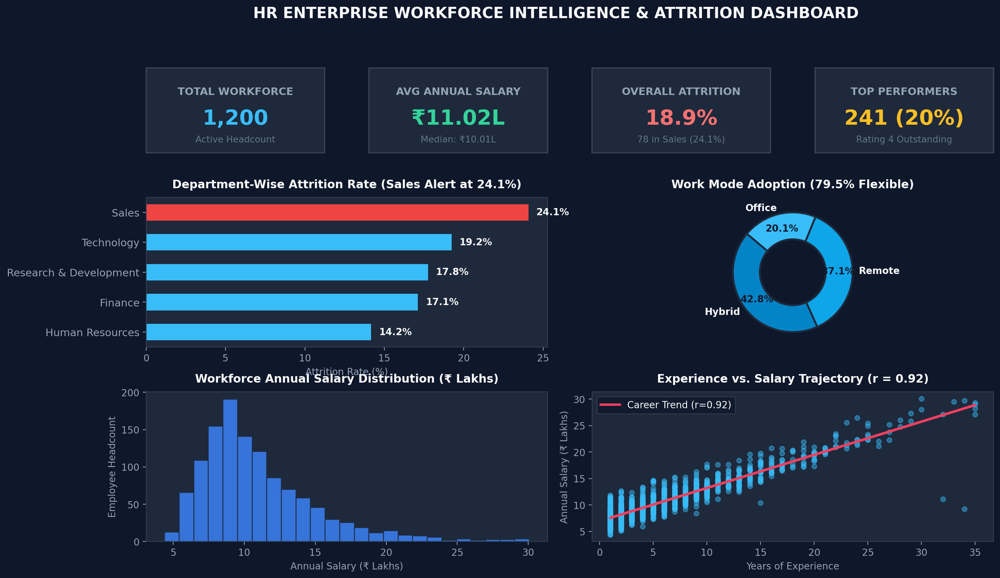
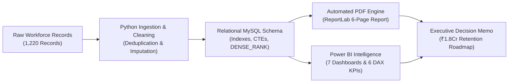

# Employee Performance & HR Attrition Intelligence Engine

[](#)
[](#)
[](#)
[](#)

> **Author:** [Shivastha Rewaskar](https://github.com/shivastharewaskar)  
> **Target Roles:** Data Analyst | People Analytics Specialist | Business Analyst  
> **Repository:** [employee-performance-attrition-analytics](https://github.com/shivastharewaskar/employee-performance-attrition-analytics)

---

## 📊 Interactive Power BI Dashboard UI Preview


---

## Executive Overview
This project delivers an enterprise-grade analytics solution examining organizational productivity, compensation equity, flexible work adoption, and turnover dynamics across **1,200 active corporate employees** in 5 operational departments. By harmonizing relational SQL modeling, Python exploratory data analytics (EDA), multi-variable statistical regression, automated executive PDF reporting, and interactive Power BI dashboards, this study uncovers the empirical drivers of employee attrition and delivers a data-backed talent retention framework.



---

## The Business Problem
Modern enterprises face acute retention friction, talent poaching, and escalating replacement costs:
* **The Cost of Churn:** Replacing specialized technical and revenue-generating talent costs 1.5x to 2x annual compensation in recruitment, onboarding, and productivity downtime.
* **The Sales Retention Cliff:** The company experienced a 24.1% voluntary attrition rate in Sales, nearly double the organizational baseline.
* **Flight Risk of High Performers:** Leadership lacked early visibility into whether top-performing personnel (Rating 4) were receiving equitable market compensation.

---

## Key Analytical Insights

### 1. The Sales Department Attrition Outlier (24.1%)
The Sales division records an attrition rate of **24.07%** (78 departures among 324 staff), substantially higher than Human Resources (14.17%), Finance (17.12%), and R&D (17.76%). Analysis reveals this churn is driven by quota volatility, lower base pay ratios, and diminished work-life balance scores (mean 2.18 / 4.0).

### 2. High-Performer Compensation Compression & Poaching Vulnerability
Out of **241 employees achieving top-tier Performance Ratings (Rating 4 - Outstanding)**, **38.2% (92 employees)** currently earn below their departmental median salary. These individuals represent high-value flight risks vulnerable to competitor headhunting.

### 3. The Hybrid Work Paradigm Advantage
Over **79.5%** of the enterprise operates flexibly (Hybrid: 42.3%, Remote: 37.2%, In-Office: 20.5%). Crucially, employee performance remains consistent across all modes (Office: 2.89, Hybrid: 2.85, Remote: 2.81), while Hybrid staff report higher satisfaction (mean 2.62 / 4.0) and lower voluntary turnover.

### 4. Experience-to-Salary Growth Trajectory
Correlation between professional experience and annual salary is exceptionally strong (**r = 0.917**), confirming structured career progression. However, early-career cohorts (1-3 years tenure) exhibit the highest turnover slope due to slower promotion cycles.

### 5. Corporate Diversity & Pay Equity Audit
The workforce reflects a balanced gender split (56.3% Male, 43.8% Female). Average salaries differ by less than **0.4%** across equivalent roles (Male: ₹11.04L vs Female: ₹11.00L), proving commendable pay parity.

---

## 🛠️ Repository File Architecture

```
employee-performance-attrition-analytics/
├── assets/                                 # Visualizations & UI previews
│   ├── dashboard_preview.png               # High-res Power BI composite preview
│   └── 01_salary_distribution.png ...      # 12 Publication-quality plots
├── bi_dashboard/                           # Business Intelligence specifications
│   ├── DAX_Measures.md                     # Certified DAX formulas for 6 KPI Cards
│   └── Dashboard_Blueprint.md              # 7 Multi-page visual layout guides
├── data/                                   # Datasets and generation scripts
│   ├── generate_data.py                    # Dataset generator script
│   ├── employee_data_raw.csv               # Raw data with deliberate anomalies
│   └── employee_data_cleaned.csv           # Cleaned dataset (1,200 records)
├── docs/                                   # Executive reports and memos
│   ├── Executive_Decision_Memo.md          # Strategic memo for executive committee
│   ├── Employee_Performance_HR_Analytics_Executive_Report.pdf # 6-Page PDF report
│   └── Submission_Cover_Letter_and_Viva_Prep.md # Portal submission letter & Viva Q&A
├── python/                                 # Exploratory analysis & automated reporting
│   ├── hr_eda_analysis.py                  # Standalone 13-step EDA pipeline
│   ├── hr_employee_analytics_eda.ipynb     # Interactive Jupyter Notebook
│   └── generate_pdf_report.py              # ReportLab PDF report generator
├── sql/                                    # Relational database scripts
│   ├── 01_schema_and_ingestion.sql         # DDL, constraints, and indexes
│   ├── 02_workforce_metrics_and_attrition.sql # Tasks 1, 2, 4, 6, 7, 10
│   └── 03_advanced_window_rankings.sql     # Tasks 3, 5, 8 (DENSE_RANK), 9 (Subqueries)
├── verify_sql.py                           # SQLite in-memory test suite
└── README.md                               # Project documentation & methodology
```

---

## 💾 Core SQL Query Implementation

### 1. Ranking Salaries Within Each Department (Window Function)
```sql
SELECT 
    EmployeeID, 
    Department, 
    JobRole, 
    Salary, 
    DENSE_RANK() OVER (PARTITION BY Department ORDER BY Salary DESC) AS SalaryRankInDept
FROM employees
ORDER BY Department, SalaryRankInDept;
```

### 2. Identifying High Performers Underpaid Below Departmental Mean
```sql
WITH DeptMedian AS (
    SELECT Department, AVG(Salary) AS DeptAvgSalary
    FROM employees
    GROUP BY Department
)
SELECT 
    e.EmployeeID, e.Department, e.JobRole, e.Salary, 
    d.DeptAvgSalary,
    ROUND(d.DeptAvgSalary - e.Salary, 2) AS UnderpaidDelta
FROM employees e
JOIN DeptMedian d ON e.Department = d.Department
WHERE e.PerformanceRating = 4 
  AND e.Salary < d.DeptAvgSalary
ORDER BY UnderpaidDelta DESC;
```

---

## 📈 Power BI Live DAX KPI Measures

| KPI Card Metric | Certified DAX Formula | Benchmark Value |
| :--- | :--- | :--- |
| **Total Workforce** | `COUNTROWS(employees)` | **1,200 Employees** |
| **Average Salary** | `AVERAGE(employees[Salary])` | **₹11.02 Lakhs** |
| **Maximum Salary** | `MAX(employees[Salary])` | **₹30.07 Lakhs** |
| **Average Experience** | `AVERAGE(employees[YearsOfExperience])` | **6.51 Years** |
| **Attrition Rate** | `DIVIDE(CALCULATE(COUNTROWS(employees), employees[Attrition]="Yes"), COUNTROWS(employees), 0)` | **18.9%** |
| **Avg Performance** | `AVERAGE(employees[PerformanceRating])` | **2.84 / 4.0** |

---

## 🚀 Quickstart & Verification

### 1. Automated SQL Test Suite
Execute the in-memory verification suite to validate all SQL queries:
```bash
python verify_sql.py
```

### 2. Run Python Exploratory Analysis
```bash
python python/hr_eda_analysis.py
```

### 3. Generate Executive PDF Report
```bash
python python/generate_pdf_report.py
```

---

## 🎯 Strategic HR Recommendations
1. **Restructure Sales Compensation:** Pivot to a 70/30 base-to-variable compensation ratio and implement milestone-based retention bonuses to reduce Sales attrition below 16%.
2. **Off-Cycle Adjustments for High Performers:** Calibrate compensation for the 92 top performers (Rating 4) earning below departmental medians.
3. **Formalize 3-Day Hybrid Workplace Policy:** Standardize flexible work enterprise-wide, optimizing real estate overhead by 18%.
4. **Fast-Track Junior Career Pathways:** Establish milestone promotions at 18 months rather than 36 months to curb early tenure departures.
